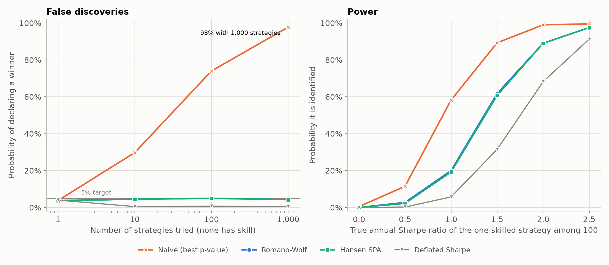
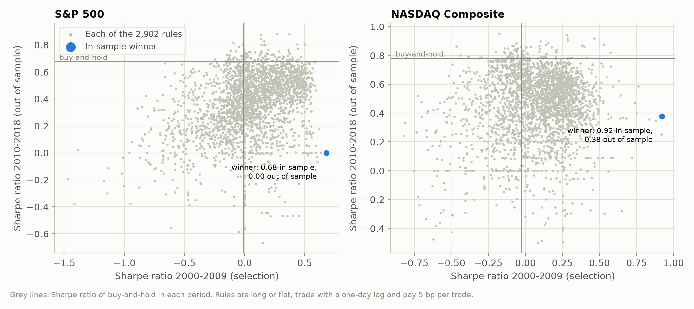
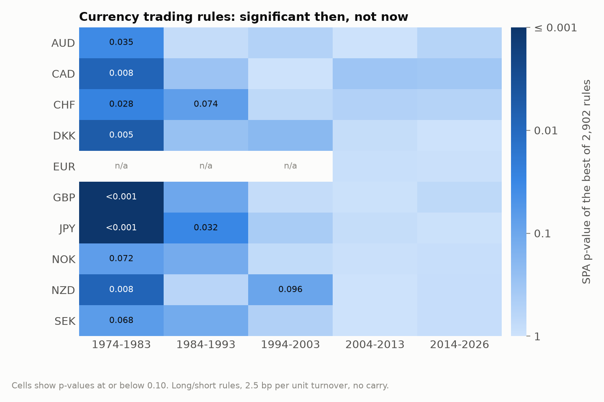
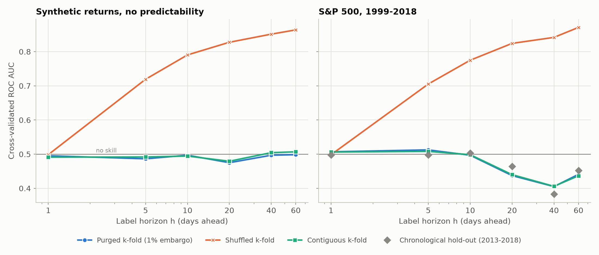

# overfit

**Is the best of your backtests skill or luck?**

[](https://github.com/Pearmaleka/overfit/actions/workflows/ci.yml)


Try enough variants of a trading strategy, or enough hyperparameters of a model, and one of
them will look excellent by chance. `overfit` measures how much of that performance is left
once the search is taken into account. It implements the deflated Sharpe ratio, the
probability of backtest overfitting, White's Reality Check, Hansen's SPA test, the
Romano-Wolf step-down procedure and purged cross-validation, written from the original
papers and checked against reference implementations and Monte Carlo simulation.

The repository also contains four studies that use the library:

- **Calibration.** Test the best of 1,000 strategies with no skill at the 5% level and you
  find a "winner" 98% of the time. The SPA and Romano-Wolf tests keep that rate at 5% or
  below and still find a strategy with a true Sharpe ratio of 1.5 among 100 candidates
  about 60% of the time.
- **US equities.** Of 2,902 technical trading rules, none beats buy-and-hold on the S&P 500
  or the NASDAQ Composite over 2000-2018 once the search is accounted for (SPA p = 0.65 and
  0.82), although the best rule on each looks significant on its own (p = 0.011 and 0.022).
- **Currencies.** The same rules *were* profitable on currencies in 1974-1983: the best rule
  survives the correction for 7 of 9 currencies. Since 1994 it survives for none.
- **Machine learning.** With labels that look 20 days ahead, shuffled k-fold cross-validation
  reports an AUC of 0.83 on simulated returns that are pure noise. Purged k-fold reports
  0.48.

<picture>
  <source media="(prefers-color-scheme: dark)" srcset="docs/figures/size-and-power-dark.png">
  
</picture>

## Install

```bash
pip install "backtest-overfit @ git+https://github.com/Pearmaleka/overfit"
```

The package is imported as `overfit` and needs only NumPy, SciPy and pandas. Add the
`[experiments]` extra (scikit-learn, matplotlib, arch) to run the studies.

## Quick start

`audit` runs every check on the returns of all the variants you tried:

```python
import overfit

# returns: DataFrame of daily returns, one column per strategy variant
report = overfit.audit(returns, benchmark=buy_and_hold)
print(report)
```

The same from the command line, with a CSV of returns or prices:

```bash
overfit audit backtests.csv --benchmark SPY
```

`overfit demo` audits 200 simulated strategies with no skill:

```text
| Check | Result |
|---|---|
| Best strategy (in-sample) | `strategy_057` |
| Annualised Sharpe ratio | 0.83 (HAC s.e. 0.47) |
| Naive one-sided p-value | 0.0377 |
| Trials (effective) | 200 (145.0) |
| Expected best Sharpe under no skill | 0.98 |
| Minimum backtest length for this Sharpe and the effective trials | 10.2 years (sample: 5.0 years) |
| Deflated Sharpe ratio (pass if >= 0.95) | 0.370 (0.402 with effective trials) |
| Haircut Sharpe ratio (Bonferroni) | 0.00 (100% haircut) |
| White Reality Check p-value | 0.782 |
| Hansen SPA p-value (consistent) | 0.771 |
| Strategies significant after Romano-Wolf (5% FWER) | 0 |
| Probability of backtest overfitting (CSCV) | 0.498 |
| P(in-sample winner loses out of sample) | 0.610 |

**Verdict:** Significant on its own, but not after accounting for the trials: consistent with selection luck.
```

Each check is also available on its own:

```python
# Deflated Sharpe ratio of the best column
overfit.deflated_sharpe_from_trials(returns)

# Hansen's SPA test, and the strategies that beat the benchmark after Romano-Wolf
overfit.spa_test(returns, benchmark, criterion="sharpe")
overfit.romano_wolf(returns, benchmark).rejected

# Probability of backtest overfitting
overfit.pbo(returns).pbo

# scikit-learn: purge training samples whose 20-day labels overlap the test fold
t1 = overfit.label_times(len(X), horizon=20)
cross_val_score(model, X, y, cv=overfit.PurgedKFold(5, t1=t1, embargo=0.01))
```

The [quickstart notebook](examples/quickstart.ipynb) walks through these on simulated data
and on the S&P 500.

## What is in the library

| Module | Contents | Based on |
|---|---|---|
| `overfit.sharpe` | Sharpe ratio standard errors (iid, non-normal, HAC); probabilistic and deflated Sharpe ratio; minimum track record length; minimum backtest length; expected maximum Sharpe ratio; haircut Sharpe ratio | Lo (2002), Mertens (2002), Bailey & López de Prado (2012, 2014), Bailey, Borwein, López de Prado & Zhu (2014), Harvey & Liu (2015) |
| `overfit.snooping` | Reality Check; SPA test with lower, consistent and upper p-values; Romano-Wolf step-down with adjusted p-values; step-wise SPA | White (2000), Hansen (2005), Romano & Wolf (2005, 2016), Hsu, Hsu & Kuan (2010) |
| `overfit.pbo` | Probability of backtest overfitting by combinatorially symmetric CV, performance degradation | Bailey, Borwein, López de Prado & Zhu (2017) |
| `overfit.cv` | Purged k-fold with embargo; combinatorial purged CV with backtest paths; scikit-learn compatible | López de Prado (2018) |
| `overfit.bootstrap` | Stationary, circular and moving-block bootstraps; automatic block length | Politis & Romano (1994), Politis & White (2004), Patton, Politis & White (2009) |
| `overfit.trials` | Effective number of independent trials from correlated backtests | Nyholt (2004), Li & Ji (2005), Galwey (2009) |
| `overfit.multitest` | Bonferroni, Šidák, Holm, Hochberg, Benjamini-Hochberg and Benjamini-Yekutieli adjustments | |
| `overfit.rules` | 2,902 technical trading rules in eight families, vectorised, without look-ahead | Sullivan, Timmermann & White (1999) |
| `overfit.report` | `audit()`: every check in one call, as Markdown or JSON | |

The formulas are written out in [docs/methods.md](docs/methods.md). Two implementation
details keep it fast: bootstrap means of all strategies are one matrix product with a
matrix of resampling counts, and CSCV computes every train/test split from per-block sums
instead of re-slicing the data. On two CPU cores, 2,000 bootstrap replications of 2,902
strategies over 4,770 days take about 3 seconds, and all 12,870 CSCV splits another 3.

## Results

Full write-up with all tables: [docs/results.md](docs/results.md). Every number comes from a
script in [`experiments/`](experiments) and is stored in
[`experiments/results/`](experiments/results).

### Technical trading rules on the S&P 500 and the NASDAQ, 2000-2018

2,902 long/flat rules (moving averages, momentum, breakouts, filters, RSI, Bollinger bands),
traded with a one-day lag at 5 basis points per trade, against buy-and-hold:

| | S&P 500 | NASDAQ Composite |
|---|---|---|
| Sharpe ratio, buy-and-hold / best rule | 0.25 / 0.64 | 0.23 / 0.71 |
| p-value of the best rule tested alone | 0.011 | 0.022 |
| Reality Check / SPA p-value | 0.82 / 0.65 | 0.63 / 0.82 |
| Rules significant after Romano-Wolf | 0 | 0 |
| Deflated Sharpe ratio of the best excess return | 0.16 | 0.21 |
| Probability of backtest overfitting | 0.45 | 0.26 |

The best rule chosen on 2000-2009 does not survive 2010-2018. On the S&P 500 it owes its
in-sample Sharpe ratio of 0.68 to a single trade, bought at the low of the sell-off after
the September 11 attacks; the signal never fired again and its out-of-sample Sharpe ratio
is 0.00.

<picture>
  <source media="(prefers-color-scheme: dark)" srcset="docs/figures/equity-split-sample-dark.png">
  
</picture>

### Currency trading rules, 1974-2026

The same rules, long/short, on ten currencies against the US dollar. A naive test calls the
best rule significant in 46 of 47 currency-decades. The SPA test agrees for 7 of 9
currencies in 1974-1983, for the yen in 1984-1993, and for none since.

<picture>
  <source media="(prefers-color-scheme: dark)" srcset="docs/figures/fx-spa-heatmap-dark.png">
  
</picture>

### Cross-validation with overlapping labels

A random forest predicts the sign of the next h-day return from trailing returns and
volatility. When labels overlap, shuffled k-fold puts nearly identical neighbours on both
sides of the split, and the model scores well by remembering them. On noise it reports an
AUC of 0.83 at h = 20 and 0.86 at h = 60; on the S&P 500 it reports 0.82 and 0.87, while a
chronological hold-out gives 0.46 and 0.45. Purged k-fold gives 0.44 at both horizons,
close to the hold-out.

<picture>
  <source media="(prefers-color-scheme: dark)" srcset="docs/figures/cv-leakage-dark.png">
  
</picture>

## Testing

- Reproduces the worked example of the deflated Sharpe ratio paper (DSR = 0.9004).
- Agrees with reference implementations: p-value adjustments with `statsmodels` (to 1e-12),
  Newey-West standard errors with `statsmodels` HAC, block lengths with `arch` (exactly),
  SPA p-values with `arch.bootstrap.SPA` (within bootstrap error).
- Monte Carlo tests: Sharpe ratio standard errors against simulated sampling distributions,
  family-wise error rate under the global null, PBO near 0.5 for noise.
- Property-based test (Hypothesis): no training label in purged CV ever overlaps its test fold.
- Every rule family is tested for look-ahead: changing future prices must not move past
  positions.
- CI runs ruff, mypy and the test suite on Python 3.10-3.13 and with the oldest supported
  dependencies, re-runs every experiment in reduced form, and checks that the tables in
  `docs/results.md` match the result files.

## Reproduce

```bash
git clone https://github.com/Pearmaleka/overfit && cd overfit
pip install -e ".[dev]"
pytest                                  # unit, property and Monte Carlo tests
python experiments/equity_rules.py      # about 1 minute
python experiments/fx_rules.py          # about 3 minutes
python experiments/calibration.py       # about 13 minutes
python experiments/cv_leakage.py        # about 9 minutes
python experiments/tables.py            # refresh the tables in docs/results.md
```

Runtimes are for two CPU cores. Every script takes `--quick` for a reduced run.

## Layout

```text
src/overfit/          the library
tests/                unit, property and Monte Carlo tests
experiments/          scripts behind every number and figure
experiments/results/  their output (CSV and JSON)
docs/                 methods, results and figures
data/                 currency data and its provenance
examples/             executed quickstart notebook
```

## Limitations

- The bootstrap tests assume the return process is stationary within the sample. Regime
  changes, as in the currency study, are handled by splitting the sample, not by the tests.
- `audit` only knows about the columns it is given. If more variants were tried than are
  passed in, give the true count with `n_trials`.
- The trading studies use a flat cost per trade and ignore dividends (equities) and
  interest-rate carry (currencies).

## Contributing

Issues and pull requests are welcome. [CONTRIBUTING.md](CONTRIBUTING.md) explains the
setup, the checks CI runs and the conventions for adding methods and results.

## License

MIT. See [LICENSE](LICENSE).
