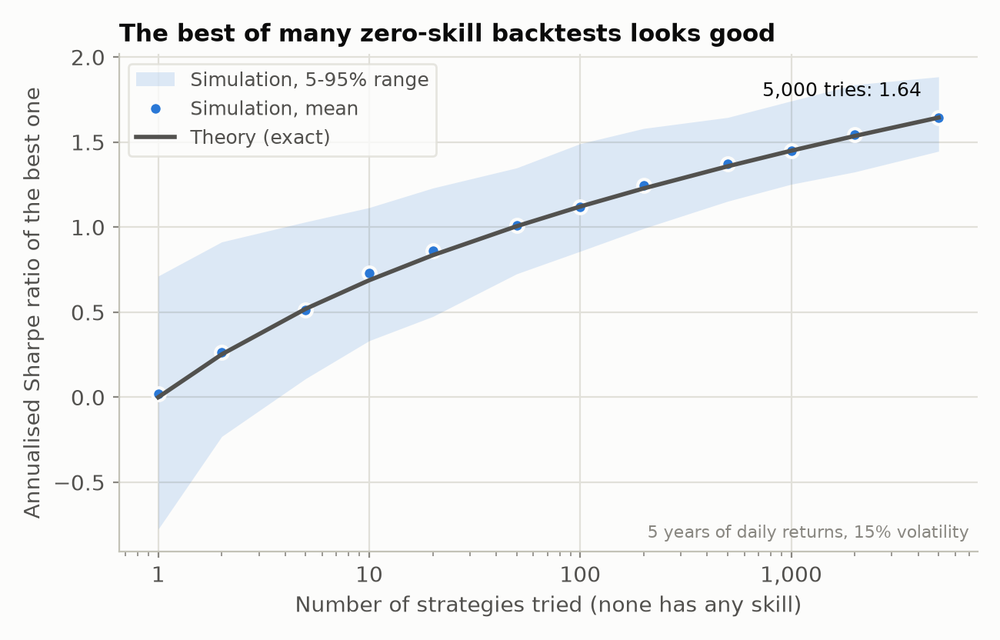
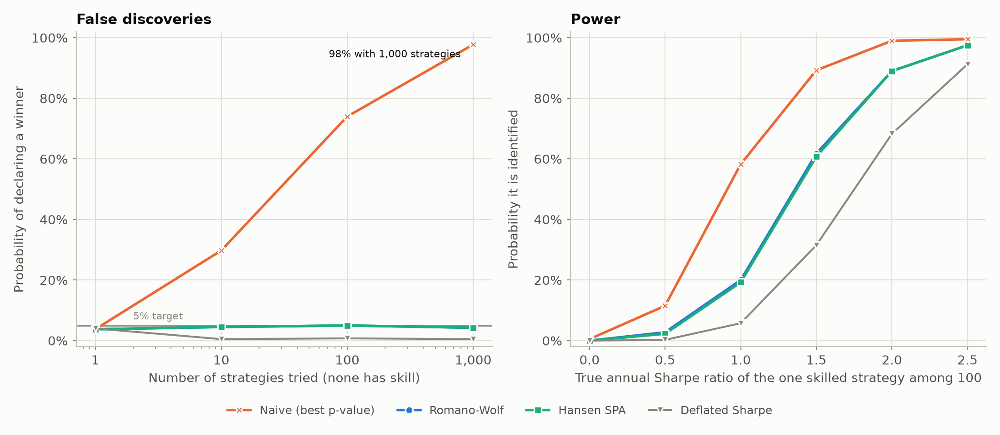
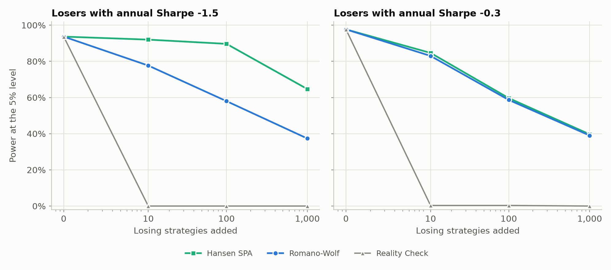
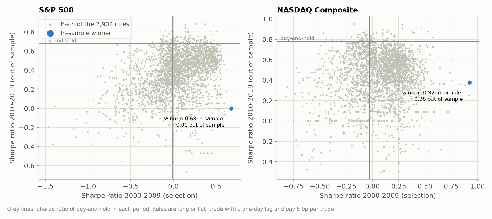
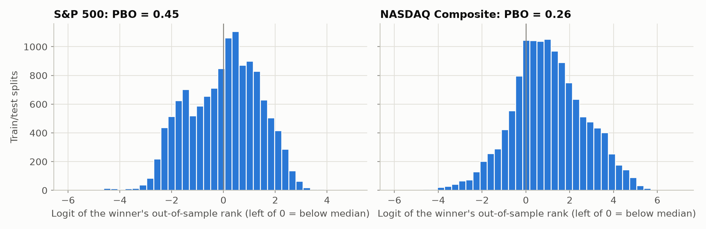
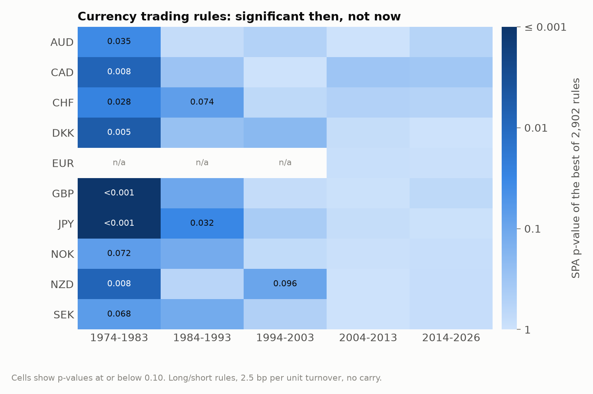
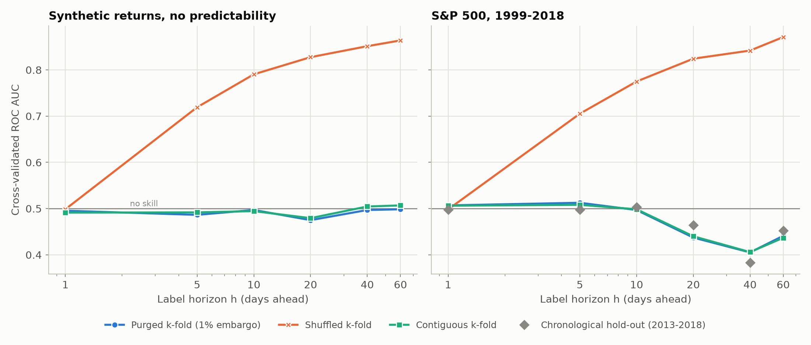

# Results

Four studies use the library. Every number on this page comes from a script in
[`experiments/`](../experiments) and is stored in [`experiments/results/`](../experiments/results);
the tables are filled in from those files by `python experiments/tables.py`, so they cannot
drift from the output. All randomness is seeded.

- [1. Monte Carlo calibration](#1-monte-carlo-calibration): do the tests keep their size, and how much power do they have?
- [2. Technical rules on US equity indices](#2-technical-trading-rules-on-the-sp-500-and-the-nasdaq-composite-2000-2018): does the best of 2,902 rules beat buy-and-hold?
- [3. Currency rules since 1974](#3-currency-trading-rules-1974-2026): did the edge disappear?
- [4. Cross-validation with overlapping labels](#4-cross-validation-with-overlapping-labels): how much does k-fold overstate skill?

## 1. Monte Carlo calibration

`experiments/calibration.py`. Each simulated strategy has five years of daily returns
(1,260 days) at 15% annual volatility. Shocks are Student t with 5 degrees of freedom,
all strategies share a GARCH(1,1) volatility factor (a = 0.06, b = 0.92), and every
pair is correlated at 0.3. The bootstrap tests use 499 stationary-bootstrap replications
with the automatic block length.

*Naive* is what a backtest report usually does: take the strategy with the smallest
one-sided HAC t-test p-value and compare it with 5%. *Deflated Sharpe* declares a winner
when the deflated Sharpe ratio of the best strategy is at least 0.95.

### 1.1 How good does the best of N useless strategies look?

Annualised Sharpe ratio of the best of N strategies with iid normal returns and zero mean
(150 replications each), against `expected_max_sharpe(method="exact")` and the
Bailey-López de Prado approximation.

<!-- table:expected_max -->
| Strategies tried | Simulated mean | Simulated 5-95% | Exact | Approximation |
|---|---|---|---|---|
| 1 | 0.02 | -0.78 to 0.71 | 0.00 | 0.00 |
| 2 | 0.27 | -0.23 to 0.91 | 0.25 | 0.23 |
| 5 | 0.51 | 0.11 to 1.03 | 0.52 | 0.53 |
| 10 | 0.73 | 0.33 to 1.12 | 0.69 | 0.70 |
| 20 | 0.86 | 0.47 to 1.23 | 0.84 | 0.85 |
| 50 | 1.01 | 0.73 to 1.35 | 1.01 | 1.02 |
| 100 | 1.12 | 0.86 to 1.49 | 1.12 | 1.13 |
| 200 | 1.25 | 0.99 to 1.58 | 1.23 | 1.24 |
| 500 | 1.37 | 1.15 to 1.65 | 1.36 | 1.37 |
| 1,000 | 1.45 | 1.25 to 1.74 | 1.45 | 1.46 |
| 2,000 | 1.54 | 1.32 to 1.84 | 1.54 | 1.54 |
| 5,000 | 1.64 | 1.45 to 1.88 | 1.64 | 1.65 |
<!-- /table -->

With five years of data, trying 100 variants of a strategy that does not work produces an
expected best Sharpe ratio of 1.12; trying 1,000 produces 1.45. Theory and simulation
agree to within Monte Carlo error.

<picture>
  <source media="(prefers-color-scheme: dark)" srcset="figures/expected-max-sharpe-dark.png">
  
</picture>

### 1.2 False discoveries when nothing works

Share of 400 replications in which each procedure declares a winner although no strategy
has skill (the family-wise error rate; the target is 5%).

<!-- table:size -->
| Procedure | 1 strategy | 10 strategies | 100 strategies | 1,000 strategies |
|---|---|---|---|---|
| Naive (best p-value) | 3.8% | 29.8% | 74.0% | 97.8% |
| Bonferroni | 3.8% | 3.8% | 4.0% | 3.2% |
| Benjamini-Hochberg | 3.8% | 4.0% | 4.5% | 3.2% |
| Reality Check | 3.8% | 4.5% | 5.0% | 3.0% |
| Hansen SPA | 3.8% | 4.5% | 5.0% | 4.2% |
| Romano-Wolf | 3.8% | 4.5% | 5.0% | 4.2% |
| Deflated Sharpe | 4.0% | 0.5% | 0.8% | 0.5% |
<!-- /table -->

The naive procedure finds a "significant" strategy 98% of the time among 1,000 useless
ones. Every correction stays at or below 5% (the Monte Carlo standard error is about 1.1
percentage points). The deflated Sharpe ratio is far below 5% as soon as there is more
than one trial: it measures the best Sharpe ratio against the *expected* maximum and then
asks for another 1.645 standard errors, which is stricter than a 5% test of the maximum.

### 1.3 Power: finding the one strategy that works

One of 100 strategies has a true annual Sharpe ratio between 0 and 2.5; the table shows how
often each procedure names that strategy (400 replications).

<!-- table:power -->
| Procedure | SR 0 | SR 0.5 | SR 1 | SR 1.5 | SR 2 | SR 2.5 |
|---|---|---|---|---|---|---|
| Naive (best p-value) | 0.5% | 11.5% | 58.2% | 89.2% | 99.0% | 99.5% |
| Bonferroni | 0.0% | 2.2% | 17.5% | 61.5% | 86.8% | 97.0% |
| Benjamini-Hochberg | 0.0% | 3.5% | 18.5% | 61.5% | 86.8% | 97.0% |
| Reality Check | 0.0% | 2.2% | 17.5% | 60.0% | 88.0% | 97.5% |
| Hansen SPA | 0.0% | 2.2% | 19.2% | 60.8% | 89.0% | 97.5% |
| Romano-Wolf | 0.0% | 2.8% | 20.0% | 61.8% | 89.0% | 97.5% |
| Deflated Sharpe | 0.0% | 0.2% | 5.8% | 31.5% | 68.2% | 91.2% |
<!-- /table -->

<picture>
  <source media="(prefers-color-scheme: dark)" srcset="figures/size-and-power-dark.png">
  
</picture>

Five years of data are not much: even a strategy with a true Sharpe ratio of 1.5 is found
only about 60% of the time once the search over 100 candidates is accounted for. Among
procedures that control the error rate, Romano-Wolf and SPA are the most powerful;
Bonferroni is close behind here because the correlation between strategies is a modest
0.3, and the bootstrap tests gain from exploiting that correlation. The deflated Sharpe
ratio has about half their power at Sharpe 1.5, the price of its very low false-positive
rate. It is better read as a conservative screen than as a 5% test.

### 1.4 Adding poor strategies

One strategy with a true annual Sharpe ratio of 1.5 is tested together with 0 to 1,000
losing strategies that are three times as volatile, with an annual Sharpe ratio of -1.5
(clearly poor) or -0.3 (mediocre). The table shows the power to detect the good one (300
replications).

<!-- table:poor -->
| Losers' Sharpe | Procedure | 0 losers | 10 losers | 100 losers | 1,000 losers |
|---|---|---|---|---|---|
| -1.5 | Reality Check | 93.7% | 0.0% | 0.0% | 0.0% |
| -1.5 | Romano-Wolf | 93.7% | 77.7% | 58.0% | 37.3% |
| -1.5 | Hansen SPA | 93.7% | 92.0% | 89.7% | 64.7% |
| -1.5 | Step-SPA | 93.7% | 92.0% | 89.7% | 64.7% |
| -0.3 | Reality Check | 97.7% | 0.3% | 0.3% | 0.0% |
| -0.3 | Romano-Wolf | 97.7% | 83.0% | 58.7% | 39.0% |
| -0.3 | Hansen SPA | 97.7% | 84.7% | 59.7% | 39.7% |
| -0.3 | Step-SPA | 97.7% | 84.7% | 59.7% | 39.7% |
<!-- /table -->

<picture>
  <source media="(prefers-color-scheme: dark)" srcset="figures/rc-vs-spa-dark.png">
  
</picture>

The table separates the two ideas in Hansen (2005):

- **Studentisation.** The Reality Check works with raw mean returns, so the bootstrap
  noise of the volatile losers dominates the maximum, and ten of them are enough to take its
  power from 94% to zero. Every other procedure divides by each strategy's standard error.
- **Recentring.** Romano-Wolf recentres every strategy at its estimated mean, so even
  hopeless strategies add noise to the maximum and power falls steadily (78%, 58%, 37%).
  SPA and step-SPA leave strategies that are clearly worse than the benchmark uncentred.
  With five years of daily data the cut-off is an annualised Sharpe ratio of about
  −0.89 (`sqrt(2 log log n / n)` per period), so losers at −1.5 are mostly ignored and
  power stays at 90% with 100 of them. Losers at −0.3 are within estimation error of the
  benchmark, cannot be ruled out and cost SPA as much power as they cost Romano-Wolf.

### 1.5 Probability of backtest overfitting

CSCV with 10 blocks (252 train/test splits) on 100 strategies, 100 replications.

<!-- table:pbo_sim -->
| Scenario (100 strategies) | Mean PBO | 10-90% range | P(winner loses out of sample) |
|---|---|---|---|
| no skill | 0.51 | 0.30 to 0.72 | 0.50 |
| one strategy with annual Sharpe 1.5 | 0.16 | 0.02 to 0.32 | 0.18 |
<!-- /table -->

With no skill the in-sample winner is a random draw out of sample and PBO is 0.5 on
average, but the middle 80% of samples range from 0.30 to 0.72. PBO is a noisy statistic
and should be read alongside the tests above.

## 2. Technical trading rules on the S&P 500 and the NASDAQ Composite, 2000-2018

`experiments/equity_rules.py`. Daily closes from 1999-01-04 to 2018-12-31 (bundled with
`arch`). The universe has 2,902 rules in eight families from `overfit.rules`:

| Family | Rules | Idea |
|---|---|---|
| Moving-average crossover | 1,164 | long while a short MA is above a long MA, with bands or delays |
| RSI mean reversion | 648 | buy when RSI is oversold, sell when overbought |
| Support/resistance breakout | 290 | buy above the recent high, sell below the recent low |
| RSI trend | 288 | buy when RSI is high, sell when it falls |
| Bollinger mean reversion | 162 | buy k standard deviations below the moving average |
| Alexander filter | 144 | buy after an x% rise from the trough, sell after a y% fall from the peak |
| Bollinger breakout | 126 | buy k standard deviations above the moving average |
| Time-series momentum | 80 | long while the n-day return is above a band |

Rules are long or flat, decide at the close of day t and earn the return from t to t+1.
Every change of position costs 5 basis points. The first 260 days warm up the
indicators, so every rule is evaluated on the same 4,770 days from 2000-01-14 to
2018-12-31. The benchmark is buy-and-hold of the price index; the index excludes
dividends and cash earns nothing, two simplifications that roughly offset each other.

### 2.1 Does the best rule beat buy-and-hold?

<!-- table:equity_tests -->
| Index | Specification | Best rule | Naive p | Reality Check p | SPA p (lower / consistent / upper) | Rules significant (Romano-Wolf / step-SPA) |
|---|---|---|---|---|---|---|
| S&P 500 | Sharpe ratio, 5 bp costs (main) | `brk:n=5,m=2,b=0.04` | 0.011 | 0.824 | 0.496 / 0.648 / 0.677 | 0 / 0 |
| S&P 500 | Mean return, 5 bp costs | `rsirev:n=28,lo=30,hi=70` | 0.059 | 0.668 | 0.678 / 0.821 / 0.843 | 0 / 0 |
| S&P 500 | Sharpe ratio, block length 20 | `brk:n=5,m=2,b=0.04` | 0.006 | 0.812 | 0.409 / 0.548 / 0.588 | 0 / 0 |
| S&P 500 | Sharpe ratio, no costs | `brk:n=5,m=2,b=0.04` | 0.009 | 0.844 | 0.307 / 0.438 / 0.450 | 0 / 0 |
| NASDAQ Composite | Sharpe ratio, 5 bp costs (main) | `bbrev:n=10,k=2,e=-1` | 0.022 | 0.632 | 0.639 / 0.817 / 0.832 | 0 / 0 |
| NASDAQ Composite | Mean return, 5 bp costs | `rsirev:n=28,lo=30,hi=75` | 0.080 | 0.793 | 0.746 / 0.914 / 0.931 | 0 / 0 |
| NASDAQ Composite | Sharpe ratio, block length 20 | `bbrev:n=10,k=2,e=-1` | 0.024 | 0.611 | 0.565 / 0.749 / 0.769 | 0 / 0 |
| NASDAQ Composite | Sharpe ratio, no costs | `bbrev:n=10,k=2,e=-1` | 0.011 | 0.503 | 0.601 / 0.750 / 0.754 | 0 / 0 |
<!-- /table -->

Measured by Sharpe ratio, the best rule on the S&P 500 (a breakout rule that is in the
market 77% of the time and trades about once every two years) earns 0.64 against 0.25 for
buy-and-hold, and a single-test bootstrap p-value of 0.011. On the NASDAQ the best rule (a
Bollinger-band mean-reversion rule, in the market 10% of the time) earns 0.71 against 0.23,
with p = 0.022. After accounting for the 2,902 rules that were tried, nothing is left:
Reality Check p-values of 0.82 and 0.63, SPA p-values of 0.65 and 0.82, and not a single
rule passes Romano-Wolf or step-SPA. The conclusion holds with mean returns instead of
Sharpe ratios, with a block length of 20 days, and without transaction costs.

### 2.2 Deflated Sharpe ratio, overfitting probability and a split sample

<!-- table:equity_summary -->
|  | S&P 500 | NASDAQ Composite |
|---|---|---|
| Buy-and-hold Sharpe ratio (annual return, max drawdown) | 0.25 (2.9%, 57%) | 0.23 (2.8%, 78%) |
| Best rule by Sharpe ratio | `brk:n=5,m=2,b=0.04` | `bbrev:n=10,k=2,e=-1` |
| Its Sharpe ratio (annual return, max drawdown) | 0.64 (7.8%, 24%) | 0.71 (6.9%, 13%) |
| Best excess Sharpe ratio over buy-and-hold (PSR) | 0.39 (0.96) | 0.30 (0.90) |
| Expected best excess Sharpe ratio with no skill | 0.62 | 0.49 |
| Deflated Sharpe ratio (effective trials) | 0.16 (0.34 with 212) | 0.21 (0.37 with 205) |
| Probability of backtest overfitting | 0.45 | 0.26 |
| 2000-2009 winner: Sharpe in / out of sample | 0.68 / 0.00 | 0.92 / 0.38 |
| Buy-and-hold Sharpe 2000-2009 / 2010-2018 | -0.01 / 0.68 | -0.03 / 0.78 |
| Rules beating buy-and-hold 2000-2009 / 2010-2018 | 63.5% / 5.2% | 72.0% / 2.6% |
| Rank correlation of rule Sharpe ratios across halves | 0.31 | 0.06 |
<!-- /table -->

The deflated Sharpe ratio is applied to returns in excess of buy-and-hold. The best excess
Sharpe ratio on the S&P 500, 0.39, has a probabilistic Sharpe ratio of 0.96 on its own.
But the best of 2,902 rules with no skill would be expected to reach 0.62, so the
deflated Sharpe ratio is 0.16. The 2,902 rules are far from independent: the eigenvalues
of their correlation matrix amount to about 210 independent trials, which raises the DSR
to 0.34 and 0.37, still far from 0.95.

PBO measures the rank of the in-sample winner *within* the universe. On the NASDAQ the
winner usually stays in the top half (PBO 0.26), but the whole universe trails
buy-and-hold out of sample, which is what the tests in 2.1 measure.

<picture>
  <source media="(prefers-color-scheme: dark)" srcset="figures/equity-split-sample-dark.png">
  
</picture>

**Split sample.** Pick the best rule on 2000-2009 and trade it in 2010-2018. On the S&P 500
the winner is `rsirev:n=10,lo=10,hi=60` (buy when the 10-day RSI falls below 10, sell when
it rises above 60). Its Sharpe ratio of 0.68 comes from a single trade: it bought at the
close of 21 September 2001, the low of the sell-off after the September 11 attacks, and
sold 14 trading days later with a 13.5% gain. The 10-day RSI never fell below 10 again in
the sample (the closest was 11.4 in August 2011), so the rule never traded after 2001 and
its 2010-2018 Sharpe ratio is 0.00. On the NASDAQ the winner falls from 0.92 to 0.38 while
buy-and-hold earned 0.78.

The decade, not the rule, explains most of the in-sample performance. 2000-2009 was a lost
decade for both indices, so 64% and 72% of the rules beat buy-and-hold by being out of the
market some of the time. In the 2010-2018 bull market 5.2% and 2.6% did.

<picture>
  <source media="(prefers-color-scheme: dark)" srcset="figures/equity-pbo-logits-dark.png">
  
</picture>

## 3. Currency trading rules, 1974-2026

`experiments/fx_rules.py`. Daily US dollar prices of ten currencies from the Federal
Reserve H.10 release ([provenance](../data/README.md)), split into decades. The same 2,902
rules are run long/short: flat becomes short, so every rule always holds one unit. A unit
of turnover costs 2.5 basis points (5 to reverse a position). The benchmark is zero:
interest-rate differentials (carry) are not in the data, so these are price-only returns.
A currency-decade is analysed when at least 90% of its business days have a price, which
leaves out the euro before 2004.

Early studies found that simple trend rules made money in currency markets in the 1970s
and 1980s, and later work found the profits fading (Olson, 2004; Neely, Weller and Ulrich,
2009). The multiple-testing tools make that statement precise.

<!-- table:fx_periods -->
| Period | Currencies | Best rule significant, naive | Best rule significant, SPA | Rules significant, step-SPA (all currencies) | Median best Sharpe | Median rule Sharpe | Previous winner's Sharpe (median) |
|---|---|---|---|---|---|---|---|
| 1974-1983 | 9 | 9 of 9 | 7 of 9 | 326 | 1.21 | 0.33 |  |
| 1984-1993 | 9 | 9 of 9 | 1 of 9 | 7 | 1.04 | 0.19 | 0.41 |
| 1994-2003 | 9 | 8 of 9 | 0 of 9 | 0 | 0.82 | 0.03 | -0.02 |
| 2004-2013 | 10 | 10 of 10 | 0 of 10 | 0 | 0.65 | -0.05 | 0.11 |
| 2014-2026 | 10 | 10 of 10 | 0 of 10 | 0 | 0.62 | -0.02 | -0.18 |
<!-- /table -->

SPA p-value of the best of 2,902 rules, by currency and decade (bold: at or below 0.05):

<!-- table:fx_grid -->
| Currency | 1974-1983 | 1984-1993 | 1994-2003 | 2004-2013 | 2014-2026 |
|---|---|---|---|---|---|
| AUD | **0.035** | 0.799 | 0.530 | 0.987 | 0.582 |
| CAD | **0.008** | 0.304 | 0.995 | 0.316 | 0.341 |
| CHF | **0.028** | 0.074 | 0.692 | 0.517 | 0.552 |
| DKK | **0.005** | 0.268 | 0.203 | 0.815 | 0.980 |
| EUR |  |  |  | 0.892 | 0.945 |
| GBP | **<0.001** | 0.102 | 0.804 | 0.968 | 0.699 |
| JPY | **<0.001** | **0.032** | 0.418 | 0.826 | 0.948 |
| NOK | 0.072 | 0.119 | 0.756 | 0.945 | 0.855 |
| NZD | **0.008** | 0.607 | 0.096 | 0.985 | 0.836 |
| SEK | 0.068 | 0.116 | 0.500 | 0.982 | 0.834 |
<!-- /table -->

<picture>
  <source media="(prefers-color-scheme: dark)" srcset="figures/fx-spa-heatmap-dark.png">
  
</picture>

In 1974-1983, the first decade of floating exchange rates, the best rule survives the
correction for 7 of 9 currencies, step-SPA finds 326 individually significant rules, and
even the median rule earned a Sharpe ratio of 0.33. One currency (the yen) survives in
1984-1993 and none after 1993. A naive test of the best rule would have reported a
significant strategy in 46 of the 47 currency-decades, including all 20 since 2004. Winners did not carry over either: the previous decade's best rule earned a
median Sharpe ratio of 0.41 in 1984-1993, and -0.02, 0.11 and -0.18 in the three decades
after.

Caveats: the H.10 rates are noon buying rates in New York, not tradable closes; 2.5 basis
points is a low cost for the 1970s; and carry could add to or subtract from these returns.

## 4. Cross-validation with overlapping labels

`experiments/cv_leakage.py`. A random forest (100 trees, minimum leaf size 3) predicts
whether the return over the next h days is positive from eight trailing features: returns
over 1, 5, 10, 20 and 60 days, volatility over 20 and 60 days and the distance from the
50-day moving average. When h > 1, the labels of neighbouring days overlap, and the slow
features barely change from one day to the next, so neighbouring samples are near-copies
of each other with near-identical labels.

Two data sets. Simulated prices with iid returns, where the true AUC is 0.5 (ten years,
six independent data sets), and the S&P 500 from 1999 to 2018 (three model seeds). For the
S&P 500 the reference is a chronological hold-out: train on data up to 2012, dropping the
last h days so that no training label reaches into the test period, and test on 2013-2018.
Every scheme uses five folds and reports the mean ROC AUC over the folds.

<!-- table:cv -->
| Data | Scheme | h = 1 | h = 5 | h = 10 | h = 20 | h = 40 | h = 60 |
|---|---|---|---|---|---|---|---|
| Synthetic, no signal | Purged k-fold (1% embargo) | 0.495 | 0.486 | 0.497 | 0.475 | 0.497 | 0.498 |
| Synthetic, no signal | Contiguous k-fold | 0.491 | 0.492 | 0.494 | 0.479 | 0.505 | 0.507 |
| Synthetic, no signal | Shuffled k-fold | 0.499 | 0.719 | 0.790 | 0.827 | 0.851 | 0.864 |
| S&P 500 | Purged k-fold (1% embargo) | 0.507 | 0.513 | 0.497 | 0.437 | 0.405 | 0.441 |
| S&P 500 | Contiguous k-fold | 0.506 | 0.508 | 0.498 | 0.440 | 0.406 | 0.437 |
| S&P 500 | Shuffled k-fold | 0.498 | 0.705 | 0.775 | 0.824 | 0.842 | 0.871 |
| S&P 500 | Chronological hold-out, 2013-2018 | 0.498 | 0.498 | 0.503 | 0.464 | 0.383 | 0.452 |
<!-- /table -->

<picture>
  <source media="(prefers-color-scheme: dark)" srcset="figures/cv-leakage-dark.png">
  
</picture>

- **Shuffled k-fold** reports an AUC that rises with the horizon, to 0.86 at h = 60, on data
  that contain no signal. The S&P 500 numbers are almost the same, so what it measures on
  the S&P 500 is the leak, not the market. A one-line change is enough to create the
  problem: `shuffle=True`, which is the default in scikit-learn's `train_test_split`.
- **Purged k-fold** stays at 0.5 on noise and close to the chronological hold-out on the
  S&P 500 (0.44 against 0.46 at h = 20). At longer horizons both fall below 0.5: whatever
  the model learns in one part of the sample reverses in another, which is itself worth
  knowing before trading it.
- **Contiguous k-fold** without purging gives almost the same numbers as purged k-fold here.
  Its leak is limited to the h samples on either side of each test fold, a small part of a
  fold of 500 (simulated) or 1,000 (S&P 500) days. The leak grows with the number of fold
  boundaries relative to the label horizon, so purging matters more with many short folds
  and in combinatorial CV, whose test sets are made of several separate groups.

## Reproducing

```bash
pip install -e ".[experiments]"
python experiments/calibration.py   # about 13 minutes on two cores
python experiments/equity_rules.py  # about 1 minute
python experiments/fx_rules.py      # about 3 minutes
python experiments/cv_leakage.py    # about 9 minutes
python experiments/tables.py        # refresh the tables on this page
```

Each script accepts `--quick` for a reduced run and `--plot-only` to redraw its figures
from the saved results.

## References

- Hansen, P. R. (2005). A test for superior predictive ability. *Journal of Business & Economic Statistics* 23(4), 365-380.
- Neely, C. J., Weller, P. A. and Ulrich, J. M. (2009). The adaptive markets hypothesis: evidence from the foreign exchange market. *Journal of Financial and Quantitative Analysis* 44(2), 467-488.
- Olson, D. (2004). Have trading rule profits in the currency markets declined over time? *Journal of Banking & Finance* 28(1), 85-105.
- Sullivan, R., Timmermann, A. and White, H. (1999). Data-snooping, technical trading rule performance, and the bootstrap. *Journal of Finance* 54(5), 1647-1691.

The methods and their references are in [methods.md](methods.md).
